

   2.0.0

# FragHub  (2.0.0)

## INSTALL INSTRUCTIONS BELLOW
[See install instructions](#installation)

## DESCRIPTION
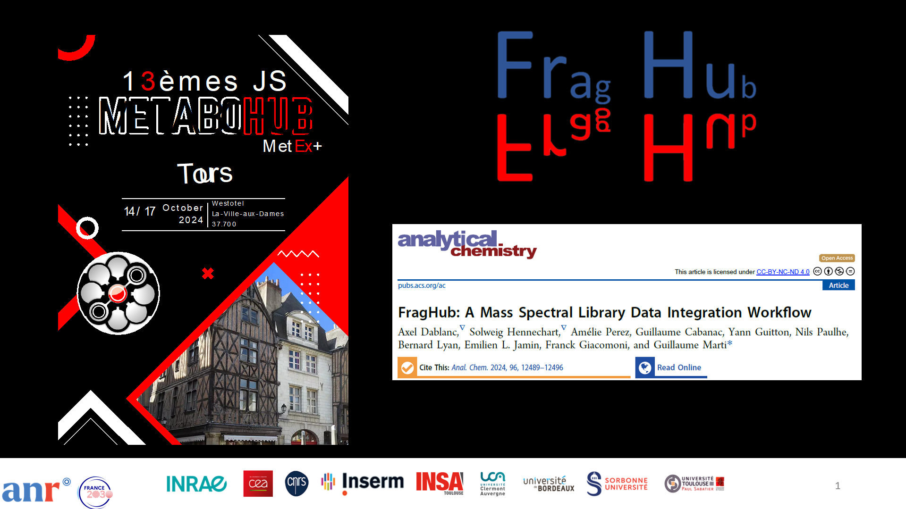
FragHub is a powerful tool designed to standardize and organize mass spectrometry (MS) data from OMSLs (Open Mass Spectra Libraries). The main objective of FragHub is to simplify and improve the process of MS data analysis by providing standardized, consistent, and easily accessible data. 
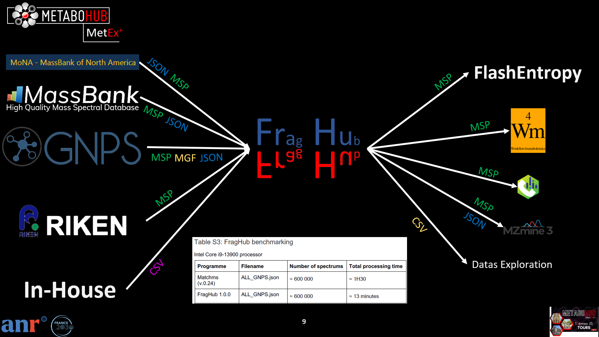
Key features: 
- **High-throughput processing**: Powered by a Rust-based core engine (via PyO3), FragHub 2.0 efficiently processes large-scale mass spectrometry libraries with significantly reduced computation times.
- **Data standardization**: FragHub standardizes field names and values of MS spectra from various databases, ensuring data consistency and compatibility.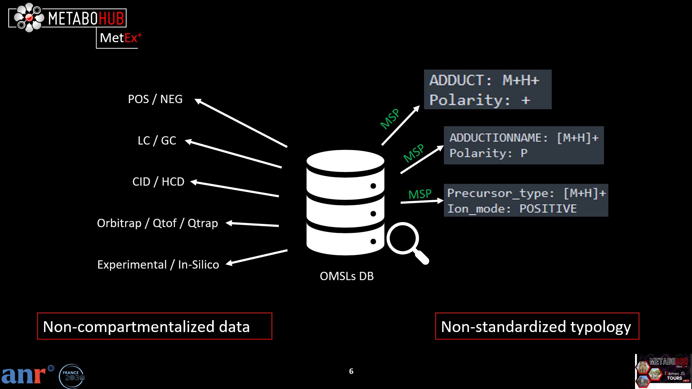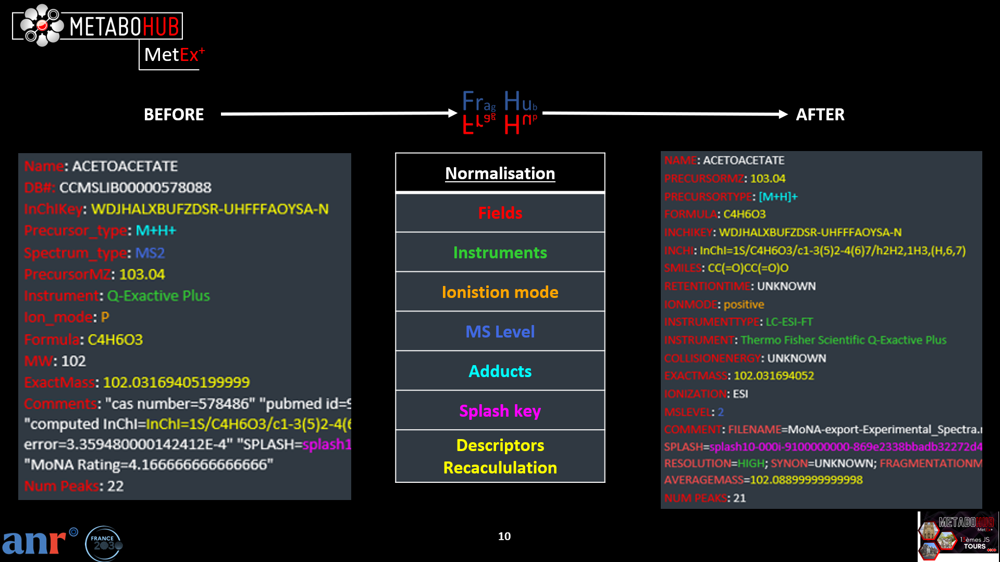
- **Optional peak list filtering**: FragHub applies filters to peak lists to streamline them by retaining only essential data, significantly reducing data size without compromising relevance for analysis.
- **Recalculation and normalization of chemical identifiers**: The program recalculates and normalizes chemical identifiers such as SMILES, InChI, and InChIKey, ensuring a uniform representation of molecular structures.
  - Salts are removed (desalting): for a structure with several components (e.g. "quinine sulfate"), the component matching the precursor m/z is kept, since only that molecule is measured.
  - Charges are neutralized when possible.
  - **InChI and InChIKey** are the standard IUPAC identifiers of this desalted, neutralized molecule, so they can be compared with PubChem and other databases.
  - **Output SMILES are normalized with RDKit**: they are written in the RDKit canonical tautomer form (stereochemistry kept), so that the same molecule is always written the same way. When the canonical tautomer would describe a different molecule (different InChI, e.g. keto/enol), the SMILES of the molecule as given is written instead. Output SMILES may therefore differ from the SMILES of the input files.
- **Ontologies**: FragHub complete ontologic information from PubChem datas bases on Inchikey.
- **Spectra organization**: FragHub separates spectra based on different experimental parameters such as polarity (positive/negative), chromatographic mode (LC/GC), and acquisition type (experimental/in silico), facilitating their use and subsequent analysis.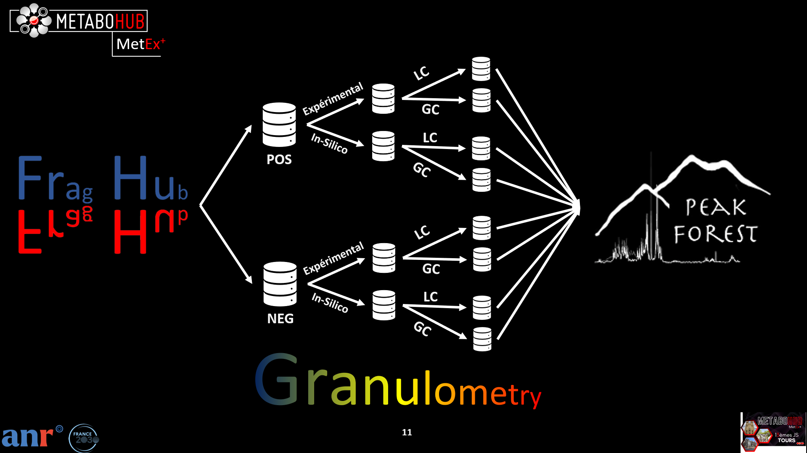
- **Compatibility with various analysis software**: Standardized spectra produced by FragHub are compatible with multiple analysis software, including MSdial, MZmine, and Flash Entropy Search, providing users with maximum flexibility in choosing analysis tools.

**Warning**: All spectra deemed inconsistent, i.e., those lacking SMILES and InChI, precursor m/z, and adduct information, are removed during the processing by FragHub.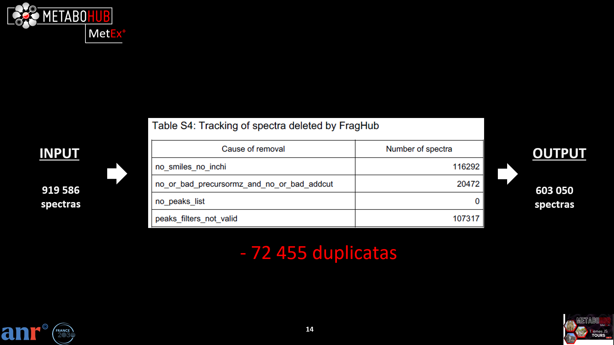

## CONTACT

* **Developer :** <axel.dablanc@utoulouse.fr>
* **Project Manager :** <guillaume.marti@utoulouse.fr>

## INSTALLATION
1) Download FragHub executable corresponding to your OS HERE: 
   ~~**Windows** x64: [Download Windows x64 Installer](https://zenodo.org/records/17235741/files/FragHub_2.0.0_setup_windows_x64.exe?download=1) 
   **Linux** x64: [Download Linux x64 Installer](https://zenodo.org/records/17235741/files/FragHub_2.0.0_setup_Linux_x64?download=1) 
   **macOS** arm64: [Download macOS arm64 app](https://zenodo.org/records/17235741/files/FragHub_macOS_2.0.0_arm64.dmg?download=1) ~~
2) Execute setup installer (macOS: drag to App)
3) select installation folder
4) click install

## USE

To use this programme:

1) Go to install directory then run FragHub executable (feel free to create shortcut).
>NB: If you have a file that contains **only** In-Silico spectra AND this is not specified within the filename or the spectrum, you can simply suffix the filename with "_insilico", like this: "UNPD_ISDB_R_p01_insilico.mgf". 
 
>NB: If you have a file that contains **only** GC spectra AND this is not specified within the filename or the spectrum, you can simply suffix the filename with "_GC", like this: "GMD_20111121_MDN35_ALK_MSP_GC.msp". 

2) FragHub GUI start: **at any time you can move the mouse over 🛈 to view a detailed description** 
   1) First tab: Select single or multiple .json, .csv, .msp, or .mgf files. 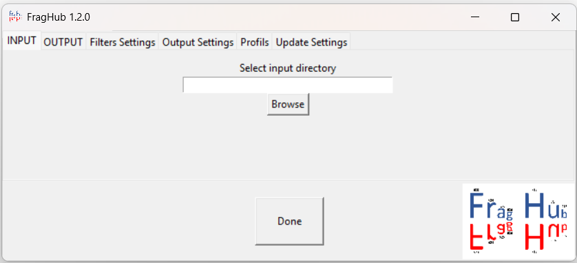
   2) Second tab: Create a new empty directory or Select an existing directory where FragHub has already written files 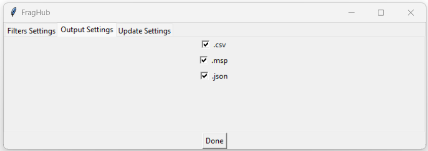
   3) Third tab: This area allows users to select specific filters for inclusion during the processing stage. Moreover, it provides the option to adjust the respective parameters of each filters. 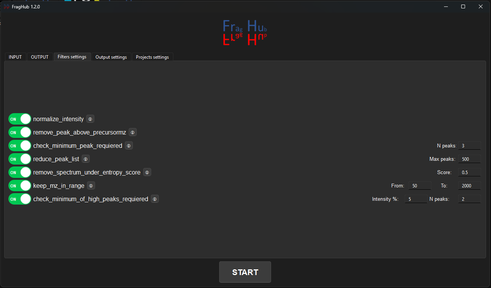
   4) Fourth tab: This area allows the user to choose whether or not to perform the calculation of de novo fragment formulas. 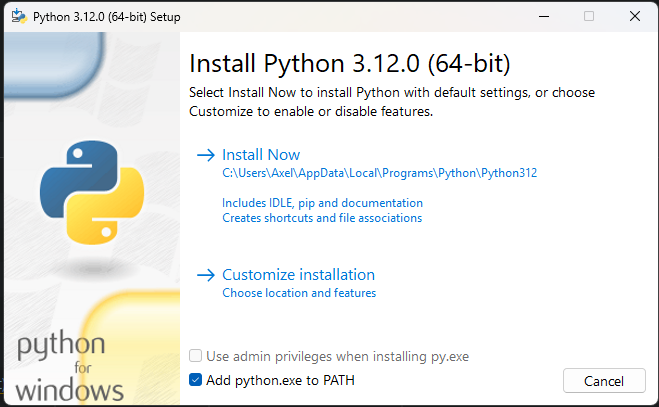
   4) Fifth tab: Select the output file format of your preference. By default, all formats are selected. 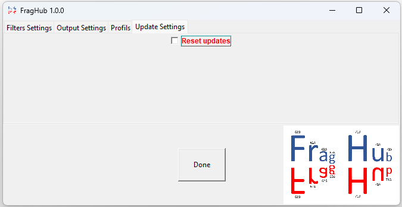
   5) Sixth tab: FragHub save the splash keys of previous spectra processed. So that at the next update, only new spectra from the database are processed, and added to previous FragHub processes. Reseting project allows you to delete splash keys and output files from the selected project, in order to start a new project from scratch. The "Write perf logs" switch (off by default) writes a performance log of the run (duration, memory and CPU usage of each step) in the PERF_LOGS sub-folder of the output directory. 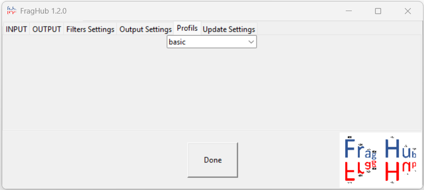
   6) Click on START button to run the programme.
3) Progress start. At any time you can click on STOP button to close the programme. 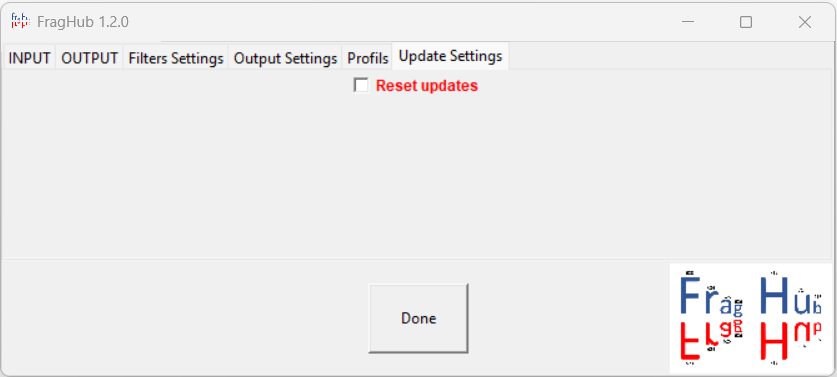
4) When Progress is finish, click on FINISH button to close the programme. 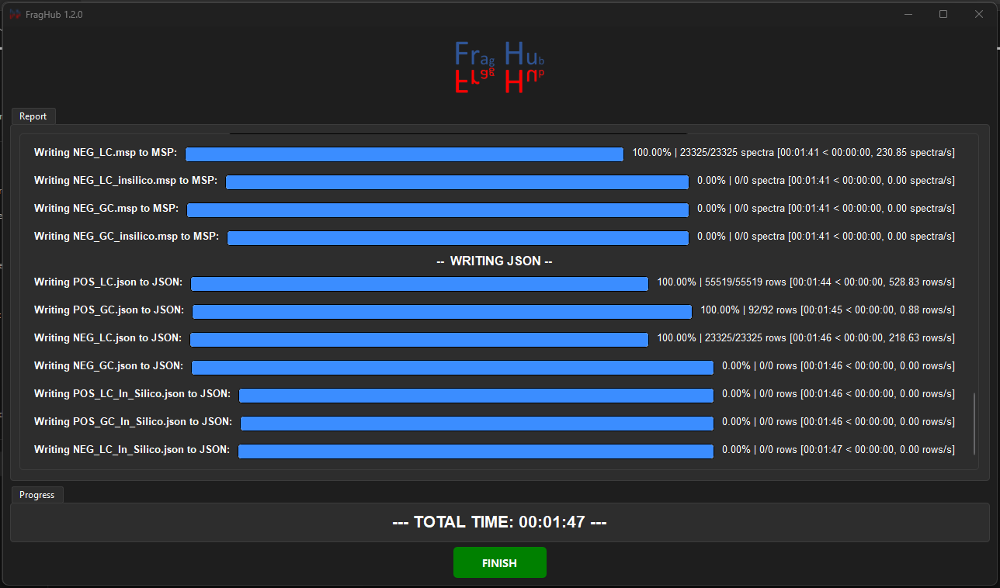
5) **DO NOT DELETE FILES INTO YOUR SELECTED OUTPUT DIRECTORY AFTER COPY CLEANED VERSIONS.**
---

## TECHNICAL DOCUMENTATION

Please refer to the [technical documentation](documentation/) for comprehensive details regarding the architecture, inner workings, and development of FragHub.

---

## HEADLESS CLI MODE

FragHub 2.0 introduces a headless Command Line Interface (CLI). This feature enables seamless integration into automated data pipelines and server environments, utilizing the Rust core engine without requiring a graphical user interface.

Please refer to the [CLI Documentation](documentation/Documentation_CLI.md) for comprehensive usage instructions, available arguments, and pipeline integration examples.

---

## FILTERS

**check_minimum_peak_requiered(peak_array, n_peaks)** 
This function checks whether a given mass spectrum contains a minimum number of peaks. If the spectrum contains fewer peaks than the minimum requirement, it ignores the spectrum. 
 
**remove_peak_above_precursormz(peak_array, precursormz)** 
This function removes all peaks from the spectrum whose m/z value is greater than the precursor's m/z value plus 5 Da. 
 
**reduce_peak_list(peak_array, max_peaks)** 
This function reduces the peak list to a specified maximum number of peaks. The peaks to retain are chosen based on their intensity, with peaks of greater intensity being selected. 
 
**normalize_intensity(peak_array)** 
This function normalizes the intensity of all the peaks in a given spectrum to the maximum intensity. 
 
**keep_mz_in_range(peak_array, mz_from, mz_to)** 
This function takes an array of peak data (representing mass-to-charge ratio, or m/z) and returns a new array containing only those peaks whose m/z value falls between mz_from and mz_to. 

**check_minimum_of_high_peaks_requiered(peak_array, intensity_percent, no_peaks)** 
This function is used to check whether a given array containing peak data has a required minimum number of "high peaks". A "high peak" is defined as a peak whose intensity is above a certain percentage (intensity_percent) of the maximum intensity. If the array does not contain a sufficient number of "high peaks", the function ignore the spectrum. 

**remove_spectrum_under_entropy_score(score)** 
The Shannon entropy score of the spectrum is calculated during processing. If a spectrum has an entropy score lower than the minimum required, it is deleted. 

## required csv file
1) CSV files need to be separated by '**;**' or '**\t**' with quotechar '**"**'. 
2) peaks columns need to be named '**peaks**'. 
3) '**peaks**' column need to be formatted with one of the following format, in string:
   1) >"[[79.054840, 12486.074219], [79.629868, 854.089905]]"
   2) > " 
   57.07042529 0.7697591662 
   71.08607535 1.507457981 
   97.06533991 0.4893302623 
   99.08098997 0.4737337839 
   137.09664 0.498920401 
   165.0915547 0.4243093978 
   " 
   3) > "314.00000000 1.00000000;315.00000000 0.15715716;316.00000000 0.35735736;317.00000000 0.05105105"
    